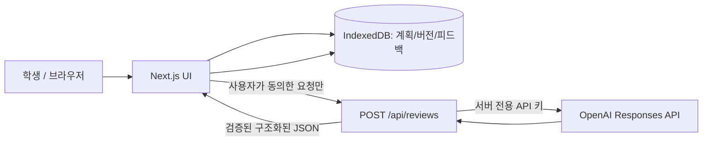

# 기술 아키텍처

## 1. 설계 선택 (원문 밖의 구현 제안)

- **웹**: Next.js App Router + TypeScript(`strict`) + Tailwind CSS.
- **UI 입력 검증**: Zod. 서버에서도 같은 제약을 독립 검증.
- **로컬 데이터**: IndexedDB + Dexie(브라우저별 영속화), 서버 측 데이터베이스 없음.
- **AI**: 서버 `/api/reviews` → OpenAI Responses API, Strict Structured Outputs(JSON Schema). 기본 모델은 하드코딩하지 않고 `OPENAI_MODEL`로 주입.
- **단위/E2E**: Vitest + Testing Library(선택) + Playwright.
- **품질**: ESLint, TypeScript, 안전한 HTML 렌더링(모델 텍스트는 HTML로 실행 금지), request body size 제한, 실패/타임아웃 처리.

선택 이유: 8주에 맞는 단일 코드베이스, 비밀키 분리, 버전과 피드백의 단순한 로컬 관리, 실제 참가자 데이터의 서버 영속화를 피할 수 있음. 절충: 기기/브라우저 간 동기화 불가, 브라우저 데이터 삭제 시 복구 불가, 단일 사용자 데모 적합.

## 2. 데이터 흐름



- 서버는 AI 요청을 처리하는 동안에만 연구계획 내용을 메모리에서 사용한다. 서버 DB, 분석 서비스, 요청 본문 로그에 복사하지 않는다.
- 모델 제공자에게 전송되는 데이터 처리 정책은 별도 고지한다. `store:false` 등의 기능은 SDK/모델 지원 여부에 따라 확인해 적용하고 **무저장 보장으로 표현하지 않는다**.
- 데모에서 사용하는 샘플 연구계획은 실존 학생 자료가 아닌 **합성 예시**다.

## 3. 앱 구조 (예상 생성 경로)

```text
src/
  app/
    page.tsx
    plans/new/page.tsx
    plans/[id]/page.tsx
    plans/[id]/compare/page.tsx
    api/reviews/route.ts
    api/health/route.ts
  components/
    PlanEditor.tsx
    PlanList.tsx
    ReviewCard.tsx
    ReviewPanel.tsx
    RevisionDiff.tsx
    ConsentDialog.tsx
  lib/
    domain/plan.ts
    domain/feedback.ts
    storage/db.ts
    storage/repository.ts
    validation/plan.ts
    validation/feedback.ts
    ai/review.ts
    ai/prompts.ts
    ai/mock.ts
    ai/client.ts
    diff/compare.ts
  tests/
    ...
```

실제 `src/` 구조는 Codex가 프로젝트 초기화 시 정하되, 데이터 계층·요청 계층·뷰 계층은 분리한다. 스키마 원본은 리포지토리 루트 `schemas/feedback.schema.json`에서 참조한다.

## 4. 환경 변수와 실행 형태

| 변수 | 위치 | 의미 |
|---|---|---|
| `OPENAI_API_KEY` | 서버 `.env.local` | OpenAI API 키. 실제 값은 저장소 밖에서 입력 |
| `OPENAI_MODEL` | 서버 `.env.local` | 검증 완료한 구조화 출력 지원 모델 ID |
| `MOCK_AI` | 서버 `.env.local` | `true`이면 합성 고정 응답 (실제 호출 금지) |
| `NODE_ENV` | 런타임 | 개발/운영 구분 |

`MOCK_AI=true`인 경우 실험 결과나 실제 모델 성능으로 간주하면 안 된다. 공개 배포 금지 상태를 기본으로 하고 로컬 데모/제한된 테스트 환경에서 사용한다. 공개 배포를 원하면 로그인/권한 검증, 과금 남용 방지, 속도 제한, 보안 정책, 비밀키 보관 등을 추가 프로젝트로 승인받아야 한다.

## 5. 데이터/보안 보호

- 한 번의 요청 길이: `API_SPEC.md`의 텍스트 제한과 64KB의 전체 HTTP 본문 상한(개발용 가드레일) 적용.
- 입력: Zod 스키마로 검증. 모든 LLM 출력은 JSON Schema로 검증 후 비즈니스 규칙(기준별 유일성·인용 일치) 검사.
- UI에서 원문/모델 텍스트를 HTML 문자열로 삽입하지 않음(XSS 완화).
- 브라우저 데이터는 암호화/접근제어가 없으므로 공용 기기 사용 시 유출 위험 경고. 실제 학생의 민감한 연구계획 수집은 보호자/기관 절차를 포함한 별도 승인·동의 계획 이후.
- AI 공급자·모델·프롬프트 버전을 결과 메타데이터로 저장; 사용자에게 비교 가능한 이력 제공.

## 6. 주요 실패 모드

| 실패 | 서버 동작 | 클라이언트 동작 |
|---|---|---|
| 필수 입력 부족 | 400 VALIDATION_ERROR | 필드 오류 표시, 내용 보존 |
| API 키/모델 설정 없음 | 503 AI_UNAVAILABLE | 원문·이전 리뷰 보존, 설정 안내 |
| 모델 거절 | 422 AI_REFUSAL | 거절/안전 이유 요약, 임의 피드백 생성 금지 |
| 요청 시간 초과 | 504 AI_TIMEOUT | 재시도 가능, 중복 실행 방지 |
| 모델 스키마 위반 | 502 INVALID_AI_OUTPUT | 내부 내용 노출 없이 오류 메시지 |
| 로컬 저장 실패 | API와 독립 | 작성 중 원문 유지, 복사·재시도 안내 |

## 7. 발전 경로 (8주 범위 밖)

사용자 인증+접근 제어를 거친 서버 영속화, 수업 단위 협업, 데이터 내보내기/복구, 도메인별 전문가 루브릭, 외부 논문 검색, 연구자 검토 연계. 핵심 MVP 변경 없이 교체 가능하도록 AI provider adapter와 storage repository interface를 분리한다.
